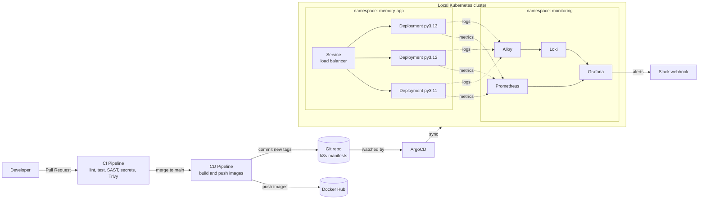

# Memory App: Secure CI/CD, GitOps and Observability

A DevSecOps / SRE reference implementation for a small Python service with a known memory leak. The service is built and scanned in a gated CI pipeline, released through a CD pipeline, deployed to a local Kubernetes cluster by ArgoCD, and observed with Prometheus, Grafana and Loki. Grafana alerts catch the pod when it is OOMKilled or becomes unready.

Everything runs locally on free and open-source tools. No cloud account is needed.

---

## Table of contents

1. [Architecture](#architecture)
2. [Repository structure](#repository-structure)
3. [Prerequisites](#prerequisites)
4. [Task 1: Docker and CI/CD](#task-1-docker-and-cicd)
5. [Task 2: GitOps with ArgoCD](#task-2-gitops-with-argocd)
6. [Task 3: Observability and alerting](#task-3-observability-and-alerting)
7. [Reproduce the environment](#reproduce-the-environment)
8. [Verify end to end](#verify-end-to-end)
9. [Design decisions](#design-decisions)
10. [Troubleshooting](#troubleshooting)
11. [Cleanup](#cleanup)

---

## Architecture



**Flow in one paragraph:** a PR to `main` triggers the CI pipeline. After merge, the CD pipeline builds one image per Python version (3.11, 3.12, 3.13), pushes them to Docker Hub, and commits the new tags back into `k8s-manifests/`. ArgoCD detects that commit and rolls out the change. Prometheus and Alloy collect metrics and logs, Grafana visualises both, and Grafana alert rules notify Slack.

---

## Repository structure

```
.
├── .github/workflows/
│   ├── ci.yml                        # PR pipeline
│   └── cd.yml                        # release pipeline
├── app/
│   └── app.py                        # the Python service
├── test/
│   └── test_case.py                  # pytest unit tests
├── k8s-manifests/                    # synced by ArgoCD (memory-app)
│   ├── namespace.yaml
│   ├── configmap.yaml
│   ├── serviceaccount.yaml
│   ├── network-policy.yaml
│   ├── resource-quota.yaml
│   ├── service.yaml
│   └── deployments/
│       ├── app-python-3.11.yaml
│       ├── app-python-3.12.yaml
│       └── app-python-3.13.yaml
├── argocd/
│   ├── root-app.yaml                 # app-of-apps, the only manual apply
│   └── apps/
│       ├── memory-app.yaml
│       ├── kube-prometheus-stack.yaml
│       ├── loki.yaml
│       ├── alloy.yaml
│       └── observability-config.yaml
├── observability/
│   ├── values/                       # Helm values (kube-prometheus-stack, loki, alloy)
│   └── config/
│       ├── dashboards/               # Grafana dashboards as ConfigMaps
│       └── alerting/                 # alert rules, contact point, notification policy
├── Dockerfile
├── .dockerignore
└── README.md
```

---

## Prerequisites

| Tool | Purpose |
|---|---|
| Docker | Build images and run the local cluster |
| kind (or Minikube / k3d) | Local Kubernetes cluster |
| kubectl | Cluster access |
| Git and a GitHub account | Repo, Actions, GitHub App |
| Docker Hub account | Image registry (free tier) |
| Slack incoming webhook | Alert notifications (optional bonus) |

Recommended cluster resources: **4 CPUs and 6-8 GB RAM**. The monitoring stack is the heaviest part.

---

## Task 1: Docker and CI/CD

### Dockerfile

```dockerfile
ARG PYTHON_VERSION=3.13
FROM python:${PYTHON_VERSION}-slim-bookworm

RUN apt-get update \
    && apt-get upgrade -y --no-install-recommends \
    && rm -rf /var/lib/apt/lists/* \
    && pip uninstall -y pip setuptools wheel

ENV PYTHONDONTWRITEBYTECODE=1 \
    PYTHONUNBUFFERED=1

WORKDIR /app

RUN groupadd -r --gid 10001 app && \
    useradd -r --uid 10001 --gid 10001 --no-create-home --shell /bin/false app

COPY --chown=app:app app/ .

USER app:app

CMD ["python", "app.py"]
```

| Practice | Why |
|---|---|
| `slim-bookworm` base | Small image and a small attack surface |
| `apt-get upgrade` at build time | Picks up Debian security fixes that the base image has not yet absorbed |
| `pip`, `setuptools` and `wheel` removed | The app has no third-party dependencies, so the packaging tools are unused. Removing them also removes the packages they vendor, which Trivy had flagged |
| Non-root user (UID/GID 10001) with no shell | Limits the impact of a compromise |
| `PYTHONDONTWRITEBYTECODE`, `PYTHONUNBUFFERED` | No `.pyc` files, and logs are flushed immediately so they reach Loki promptly |
| Python version as a build arg | One Dockerfile builds all three image variants |

> If dependencies are added later, install them in an earlier step or a build stage, and remove pip at the end.

### CI pipeline (`.github/workflows/ci.yml`)

**Trigger:** pull requests to `main` (opened, synchronize, reopened, ready for review) that touch `app/**`, `test/**`, `Dockerfile` or the workflows. Draft PRs are skipped.

| Job | What it does | Matrix |
|---|---|---|
| `test-lint-sast` | pytest unit tests, Flake8 lint (max line length 100), Bandit SAST (`B104` skipped because binding to `0.0.0.0` is required in a container) | Python 3.11, 3.12, 3.13 |
| `secret-scan` | Gitleaks over the full git history | none |
| `image-build-and-scan` | Builds each image (`--pull --no-cache`) and scans it with Trivy for OS and library vulnerabilities (HIGH and CRITICAL, unfixed ignored, **exit code 1 on findings**) | Python 3.11, 3.12, 3.13 |

`image-build-and-scan` only starts when `test-lint-sast` and `secret-scan` pass, so no image is built from code that fails the earlier gates.

### Branch protection

Configured under **Settings → Branches → Branch protection rule** for `main`:

- Require a pull request before merging (no direct pushes)
- Require status checks to pass before merging, with these checks selected:
  - `test-lint-sast (3.11)`, `test-lint-sast (3.12)`, `test-lint-sast (3.13)`
  - `secret-scan`
  - `image-build-and-scan (3.11)`, `image-build-and-scan (3.12)`, `image-build-and-scan (3.13)`
- Require branches to be up to date before merging
- Include administrators

> Status checks only appear in the selector after they have run at least once. Open a test PR first.

### CD pipeline (`.github/workflows/cd.yml`)

**Trigger:** push to `main` (that is, a merged PR), ignoring changes to `k8s-manifests/**`, `observability/**`, `argocd/**`, the CD workflow itself and the README. The path filter prevents the pipeline from re-triggering on its own manifest commit.

| Job | What it does |
|---|---|
| `release` (matrix 3.11, 3.12, 3.13) | Logs in to Docker Hub, builds each image and pushes it as `<user>/memory-app:python-<version>-sha-<short-sha>` |
| `update-manifest` | Generates a GitHub App token, rewrites the `image:` line in each `k8s-manifests/deployments/app-python-<version>.yaml`, and commits the change to `main` |

Images are tagged with the commit SHA and are never `latest`, so every deployment is traceable and every rollback is a `git revert`.

**Required repository secrets**

| Secret | Purpose |
|---|---|
| `DOCKER_USERNAME` | Docker Hub username |
| `DOCKER_PASSWORD` | Docker Hub access token |
| `APP_ID` | GitHub App ID used for the manifest commit |
| `APP_PRIVATE_KEY` | GitHub App private key |

The GitHub App needs **Contents: read and write** permission and must be allowed to bypass the pull-request requirement on `main`. This is what lets the pipeline push the tag update while humans still cannot push directly.

---

## Task 2: GitOps with ArgoCD

### Workloads

| Resource | Details |
|---|---|
| Namespace | `memory-app` |
| Deployments | Three, one per Python version (`app-python-3.11`, `3.12`, `3.13`), all running at the same time |
| Service | One shared Service selecting the common `app: memory-app` label, so traffic is balanced across all three Deployments |
| Memory limit | **400Mi** on every pod, so the leaking app is OOMKilled before it can threaten the node |
| Requests and limits | Set on all pods |

### Production-grade footprint

| Requirement | Implementation |
|---|---|
| Namespaces | Dedicated `memory-app` namespace, separate from `monitoring` and `argocd` |
| ConfigMaps and Secrets | `configmap.yaml` holds non-sensitive config. The Slack webhook is a Secret created out-of-band and never committed |
| initContainers | Used by the Deployments (see the manifests in `k8s-manifests/deployments/`) |
| RBAC | Dedicated ServiceAccount in `serviceaccount.yaml` with least-privilege permissions |
| NetworkPolicy | Ingress to app pods is limited to port 8080 from within the `memory-app` namespace |
| ResourceQuota | Caps total CPU, memory and pod count in the namespace |

> NetworkPolicies are only enforced if the cluster CNI supports them. kind's default CNI does not. Use Calico or Cilium if you want enforcement.

### ArgoCD

ArgoCD uses an **app-of-apps** pattern. One manual `kubectl apply` of `argocd/root-app.yaml` creates every other Application:

| Application | Source | Destination namespace |
|---|---|---|
| `memory-app` | `k8s-manifests/` (recursive) | `memory-app` |
| `kube-prometheus-stack` | Helm chart plus `observability/values/` | `monitoring` |
| `loki` | Helm chart plus `observability/values/` | `monitoring` |
| `alloy` | Helm chart plus `observability/values/` | `monitoring` |
| `observability-config` | `observability/config/` (recursive) | `monitoring` |

All Applications use automated sync with `prune` and `selfHeal`, so Git is the single source of truth and manual `kubectl` edits are reverted.

**Image update loop:** merge to `main`, then the CD pipeline pushes images and commits new tags to `k8s-manifests/`, then ArgoCD detects the commit and syncs, so the pods are rolled with the new images.

---

## Task 3: Observability and alerting

### Stack

| Component | Role | Installed via |
|---|---|---|
| Prometheus | Metrics (includes node-exporter and kube-state-metrics) | `kube-prometheus-stack` Helm chart |
| Grafana | Dashboards and alerting | `kube-prometheus-stack` Helm chart |
| Loki | Log storage (single-binary, filesystem) | `loki` Helm chart |
| Alloy | Log collection from pods | `alloy` Helm chart |

Alertmanager is **disabled**. Alerting is done entirely by Grafana, as the task requires. Everything, including dashboards and alerts, is managed in Git and applied by ArgoCD.

### Dashboards

Dashboards are stored as ConfigMaps labelled `grafana_dashboard: "1"` and loaded automatically by the Grafana sidecar.

| Dashboard | Shows |
|---|---|
| Node metrics | Node CPU, memory and disk usage |
| Kubernetes / kube-state-metrics | Pod and cluster metrics: CPU and memory per pod, restarts, pod status |
| Logs (Loki datasource) | Central application logs, filter with `{namespace="memory-app"}` in Explore |

### Alerts

Alert rules, the Slack contact point and the notification policy are provisioned from ConfigMaps labelled `grafana_alert: "1"`.

| Alert | Condition | Severity |
|---|---|---|
| Pod not ready | `kube_pod_status_ready{namespace="memory-app",condition="false"} == 1` for 1m | critical |
| Pod OOMKilled | Last terminated reason is `OOMKilled` and the container restart count increased in the last 5 minutes | critical |

Notifications go to Slack through a webhook read from the `SLACK_WEBHOOK_URL` environment variable, which comes from a Kubernetes Secret. The webhook is never stored in Git.

---

## Reproduce the environment

### 1. Fork and configure the repository

1. Fork or clone this repository.
2. Replace `<your-user>/<your-repo>` in `argocd/root-app.yaml` and every file under `argocd/apps/`.
3. Add the repository secrets listed in [CD pipeline](#cd-pipeline-githubworkflowscdyml).
4. Create the branch protection rule described in [Branch protection](#branch-protection).
5. If the repo is private, add repo credentials in ArgoCD under **Settings → Repositories**.

### 2. Create the cluster

```bash
kind create cluster --name memory-app
kubectl cluster-info --context kind-memory-app
```

### 3. Install ArgoCD

```bash
kubectl create namespace argocd
kubectl apply -n argocd --server-side \
  -f https://raw.githubusercontent.com/argoproj/argo-cd/stable/manifests/install.yaml
kubectl -n argocd rollout status deploy/argocd-server
```

Log in to the UI:

```bash
kubectl -n argocd get secret argocd-initial-admin-secret \
  -o jsonpath="{.data.password}" | base64 -d; echo
kubectl -n argocd port-forward svc/argocd-server 8081:443
# open https://localhost:8081  (user: admin)
```

### 4. Create the Slack webhook Secret

Must exist before Grafana starts:

```bash
kubectl create namespace monitoring
kubectl -n monitoring create secret generic slack-webhook \
  --from-literal=SLACK_WEBHOOK_URL='<your-slack-webhook-url>'
```

### 5. Bootstrap everything

```bash
kubectl apply -f argocd/root-app.yaml
```

ArgoCD now creates all five Applications. Some may show *OutOfSync* or *Degraded* for a minute or two while dependencies come up. This resolves on its own.

### 6. Access the UIs

```bash
# Grafana
kubectl -n monitoring port-forward svc/kube-prometheus-stack-grafana 3000:80
# open http://localhost:3000
```

The Grafana admin password is set in `observability/values/kube-prometheus-stack.yaml`, or can be read from the `kube-prometheus-stack-grafana` Secret.

---

## Verify end to end

| Step | Expected result |
|---|---|
| `kubectl get pods -n memory-app` | Three pods running, one per Python version |
| ArgoCD UI | All five Applications *Synced* and *Healthy* |
| Grafana, Explore, Loki, `{namespace="memory-app"}` | Application logs appear |
| Grafana dashboards | Node and pod metrics are populated |
| Wait about 2-5 minutes | Pods hit 400Mi, get OOMKilled and restart (`kubectl get pods -n memory-app -w`) |
| Grafana, Alerting | *Pod OOMKilled* fires, then *Pod not ready* if a restart is slow |
| Slack | Notification received |
| Open a PR that breaks lint or adds a vulnerable package | CI fails and merge is blocked |
| Merge a passing PR | Images pushed, tags updated in `k8s-manifests/`, ArgoCD rolls the pods |

Useful commands:

```bash
kubectl describe pod <pod> -n memory-app      # shows "Last State: Terminated, Reason: OOMKilled"
kubectl get events -n memory-app --sort-by=.lastTimestamp
kubectl top pods -n memory-app                # needs metrics-server
```

---

## Design decisions

| Decision | Reasoning |
|---|---|
| Matrix over Python 3.11 / 3.12 / 3.13 | Mirrors the three deployments and validates the app on each supported runtime |
| Trivy gate with `ignore-unfixed` | Fails only on vulnerabilities that can actually be fixed, which avoids permanent red builds |
| SHA-based image tags | Immutable, traceable and easy to roll back |
| GitHub App for the manifest commit | Short-lived scoped tokens, and a precise bypass of branch protection instead of a personal token |
| Path filters on CD | Prevents the manifest commit from triggering another release |
| App-of-apps | One command to rebuild the whole platform from Git |
| Grafana-managed alerts, no Alertmanager | Meets the task requirement and keeps the stack smaller |
| Loki single-binary with filesystem storage | Light enough for a local cluster while still giving central log aggregation |
| Alloy for log collection | The current Grafana-supported collector (Promtail is deprecated) |
| Everything provisioned from Git | Dashboards, alerts and config are reviewed, versioned and reproducible |

---

## Troubleshooting

| Symptom | Likely cause and fix |
|---|---|
| Prometheus CRD sync fails with *annotation too long* | Make sure `ServerSideApply=true` is set on the `kube-prometheus-stack` Application |
| Grafana pod stuck in `CreateContainerConfigError` | The `slack-webhook` Secret is missing in `monitoring`. Create it, then restart Grafana |
| Dashboards or alerts do not appear | ConfigMaps must be in the `monitoring` namespace and carry the right label (`grafana_dashboard` or `grafana_alert`) |
| An alert rule is silently not loaded | Provisioning schema mismatch. Build the rule in the Grafana UI, use **Export**, and compare |
| No logs in Loki | Check the `alloy` Application is Healthy and the Loki URL in `observability/values/alloy.yaml` is correct |
| NetworkPolicy has no effect | The CNI does not enforce it (kind's default). Use Calico or Cilium |
| CI status checks are missing from the branch protection selector | They must have run once. Open a test PR first |
| CD pipeline cannot push to `main` | The GitHub App must be allowed to bypass the PR requirement |
| CI fails on a new Trivy finding | Rebuild to pick up fresh OS packages. If the fix is not published yet, wait or re-run later |

---

## Cleanup

```bash
kind delete cluster --name memory-app
```